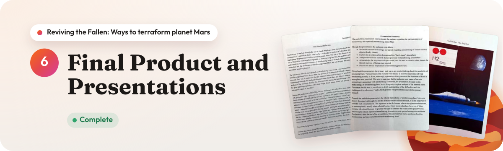
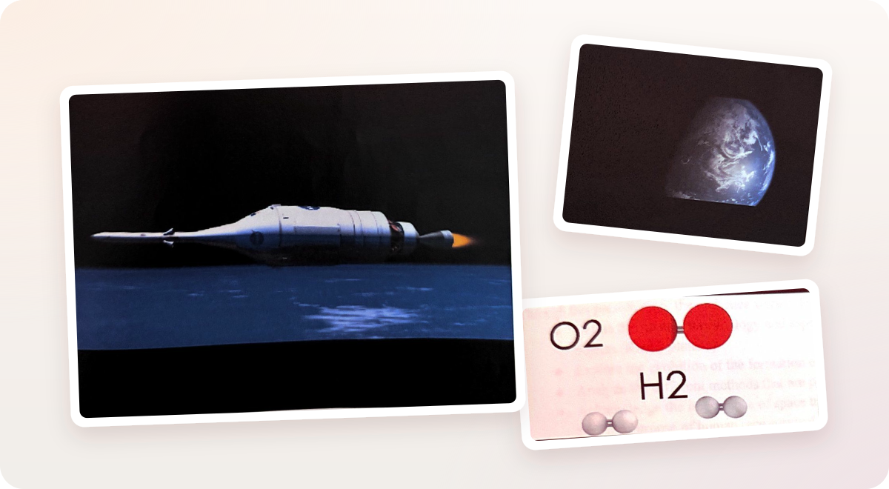
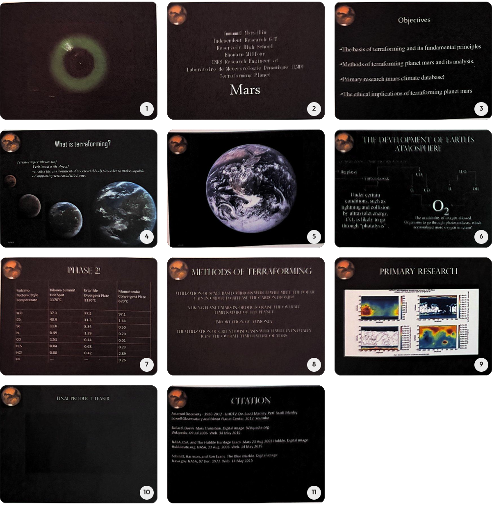
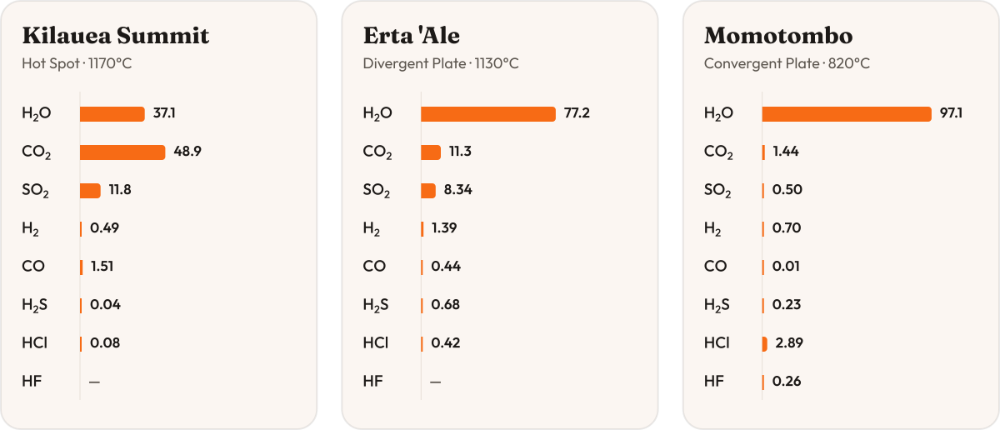
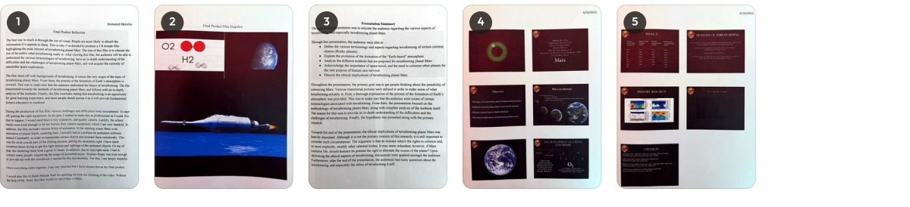

# Final Product and Presentations

Tahalil Morsilin

## Final Product Reflection

The best way to teach is through the use of visual. People are more likely to absorb the information if it appeals to them. This is why I've decided to produce a 5-8 minute film highlighting the peak interest of terraforming planet Mars. The aim of this film is to educate the rest of the public what terraforming really is. After viewing this film, the audience will be able to understand the various terminologies of terraforming, have an in-depth understanding of the difficulties and the challenges of terraforming planet Mars, and will acquire the curiosity of interstellar space exploration.

The film starts off with backgrounds of terraforming. It covers the very origin of the topic of terraforming planet Mars. From there, the process of the formation of Earth's atmosphere is covered. This was to make sure that the audience understand the basics of terraforming. The fim transitioned towards the methods of terraforming planet Mars, and follows with an in-depth analysis of the methods. Finally, the film concludes stating that terraforming is an opportunity for great learning experience, and more people should pursue it as it will provide fundamental science education to mankind.

During the production of this film, various challenges and difficulties were encountered. To start off, getting the right equipment. In my part, I wanted to make this as professional as I could. For that to happen, I would need have a very expensive, and quality camera. Luckily, the school media were kind enough to let me borrow their camera equipment, which I am very thankful. In addition, the film includes various forms of animation. In the opening scene, there is an animation of planet Earth, zooming back. I actually had to purchase an animation software named Cinema4D, in order to manipulate certain objects and animate them realistically. This was the most crucial part of the filming process; getting the animation right. I have spent countless hours trying to get the right texture and lightings of the animated objects. On top of that, the rendering itself took a good 12 hours. In addition, due to copyright issue, I had to contact many people, requesting the usage of orchestral music. Stephen Rippy was kind enough to provide me with the soundtrack I needed for this documentary. For that, I am deeply thankful.

Once everything came together, I am very satisfied that I have chosen this as my final product.

I would also like to thank Mikaze Noel for assisting me with the shooting of the video. Without the help of Mr. Noel, this film would not have been a reality.

### Final Product Film Snapshot

> **Printed page:** Three stills from the film: a rocket launching above the blue edge of Earth, an animated O2 and H2 molecule diagram, and planet Earth seen from space.

## Presentation Summary

The goal of this presentation was to educate the audience regarding the various aspects of terraforming, and especially terraforming planet Mars.

Through this presentation, the audience were able to ...

- Define the various terminology and aspects regarding terraforming of certain celestial objects (Rocky planets)
- Explore the evolution of the formation of the "Earth-based" atmosphere
- Analyze the different methods that are proposed for terraforming planet Mars
- Acknowledge the importance of space travel, and the need to colonize other planets for the sole purpose of human race survival.
- Discuss the ethical implications of terraforming planet Mars.

Throughout the presentation, the primary goal was to get people thinking about the possibility of colonizing Mars. Various transitional pictures were utilized in order to make sense of what terraforming actually is. First, a thorough explanation of the process of the formation of Earth's atmosphere was provided. This was to make sure that the audience were aware of certain terminologies associated with terraforming. From there, the presentation focused on the methodology of terraforming planet Mars, along with complete analysis of the methods itself. The reason for this was to provide an in-depth understanding of the difficulties and the challenges of terraforming. Finally, the hypothesis was presented along with the primary research.

Towards the end of the presentation, the ethical implications of terraforming planet Mars was heavily discussed. Although it is not the primary concern of this research, it is still important to consider such circumstances. The argument is that do humans inherit the rights to colonize and, or more explicitly, modify other celestial bodies. It may seem redundant, however, if Mars contains life, should humans be granted the right to alternate the course of the planet? Upon delivering the ethical aspects of terraforming, discussions were sparked amongst the audience. Furthermore, after the end of the presentation, the audiences had many questions about the terraforming, and especially the ethics of terraforming it self.

## Presentation Slides (6/10/2015)

The slides were printed as small handouts, so the text below is read from those thumbnails. Some of the fine print was too small to read and is marked as such.

1. **Opening slide:** A glowing green ring on a dark background.
2. **Title slide:** Tahalil Morsilin / Independent Research G/T / Reservoir High School / Ehouarn Millour / CNRS Research Engineer at / Laboratoire de Meteorologie Dynamique (LMD) / Terraforming Planet **Mars**
3. **Objectives**
   - The basis of terraforming and its fundamental principles
   - Methods of terraforming planet mars and its analysis.
   - Primary research (mars climate database)
   - The ethical implications of terraforming planet mars
4. **What is terraforming?** Terraform (ter·uh-form), verb (used with object): to alter the environment of (a celestial body) in order to make capable of supporting terrestrial life forms. Shown with images of Mars changing step by step into an Earth-like planet.
5. **Earth:** A full image of planet Earth.
6. **The Development of Earth's Atmosphere:** A diagram of carbon dioxide and water breaking down into O, CO, H and OH, and combining into O₂. The captions read: "Under certain conditions, such as lightning and collision by ultraviolet energy, CO₂ is likely to go through "photolysis"" and "The availability of oxygen allowed Organisms to go through photosynthesis, which accumulated more oxygen in return!" (Some of the smaller diagram labels are illegible.)
7. **Phase 2!** Volcanic gas composition:

   | Volcano / Tectonic Style / Temperature | Kilauea Summit, Hot Spot, 1170°C | Erta 'Ale, Divergent Plate, 1130°C | Momotombo, Convergent Plate, 820°C |
   |---|---|---|---|
   | H₂O | 37.1 | 77.2 | 97.1 |
   | CO₂ | 48.9 | 11.3 | 1.44 |
   | SO₂ | 11.8 | 8.34 | 0.50 |
   | H₂ | 0.49 | 1.39 | 0.70 |
   | CO | 1.51 | 0.44 | 0.01 |
   | H₂S | 0.04 | 0.68 | 0.23 |
   | HCl | 0.08 | 0.42 | 2.89 |
   | HF | — | — | 0.26 |

   <picture>
     <source media="(prefers-color-scheme: dark)" srcset="../assets/figures/volcanic-gases-dark.svg">
     
   </picture>

8. **Methods of Terraforming**
   - Utilization of space based mirrors which will melt the polar caps in order to release the carbon dioxide
   - Nuking planet Mars in order to raise the overall temperature of the planet
   - Importation of ammonia
   - The utilization of greenhouse gases which will eventually raise the overall temperature of Mars
9. **Primary Research:** The four Mars Climate Database maps from the primary research.
10. **Final Product Teaser:** A slide for playing the film teaser.
11. **Citation**
    - Asteroid Discovery - 1980-2012. Dir. Scott Manley. Perf. Scott Manley. Lowell Observatory and Minor Planet Center, 2012. Youtube.
    - Ballard, Dawn. Mars Transition. Digital image. Wikipedia.org. Wikipedia, 09 Jul 2006. Web. 14 May 2015.
    - NASA, ESA, and The Hubble Heritage Team. Mars 23 Aug 2003 Hubble. Digital image. Hubblesite.org. NASA, 23 Aug. 2003. Web. 14 May 2015.
    - Schoutt, Harrison, and Ron Evans. The Blue Marble. Digital image. Nasa.gov. NASA, 07 Dec. 1972. Web. 14 May 2015.

## Scans

The original printed pages.

1. [Final Product Reflection](scans/page-1-final-product-reflection.jpg)
2. [Final Product Film Snapshot](scans/page-2-film-snapshot.jpg)
3. [Presentation Summary](scans/page-3-presentation-summary.jpg)
4. [Presentation slides 1–6](scans/page-4-slides-1-6.jpg)
5. [Presentation slides 7–11](scans/page-5-slides-7-11.jpg)

