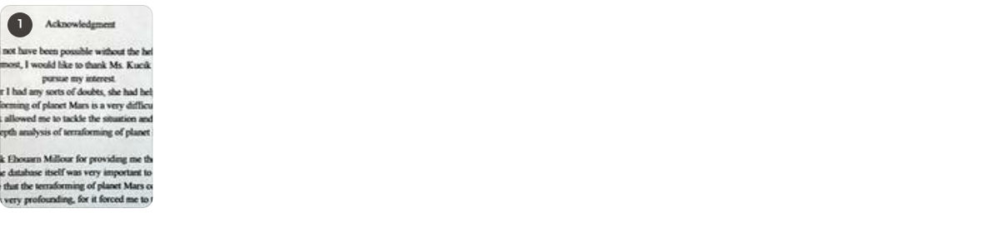

# Acknowledgements

Tahalil Morsilin

## Acknowledgment

This research would not have been possible without the help of many individual.  
First and foremost, I would like to thank Ms. Kucik for helping me  
pursue my interest.  
From time to time, whenever I had any sorts of doubts, she had helped me see the bigger picture.  
Terraforming of planet Mars is a very difficult topic.  
However, Ms. Kucik allowed me to tackle the situation and helped understand an  
in-depth analysis of terraforming of planet Mars.

I would also like to thank Ehouarn Millour for providing me the Mars Climate Database.  
The database itself was very important to me.  
It reassured me that the terraforming of planet Mars could be a reality.  
My interview with him was very profounding, for it forced me to think deeper into my project.

## Scans

The original printed pages.

1. [Page 1](scans/page-01.jpg)

