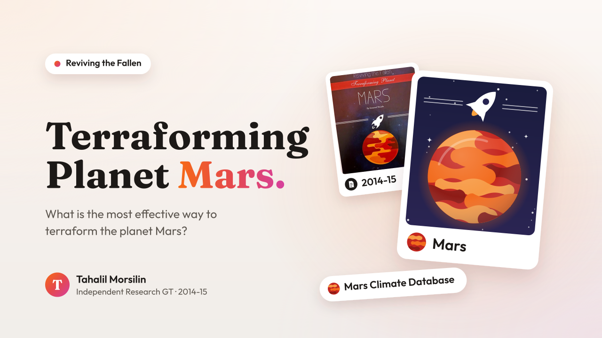
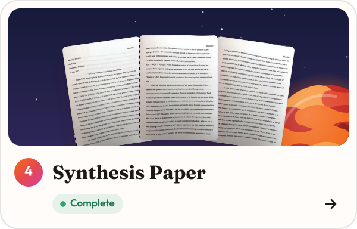
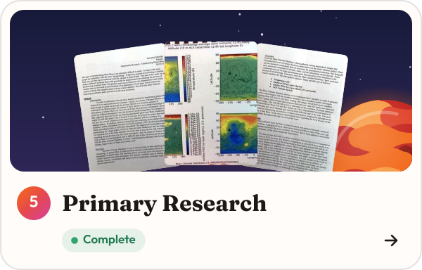
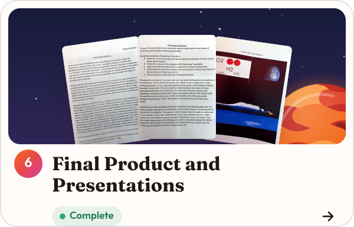
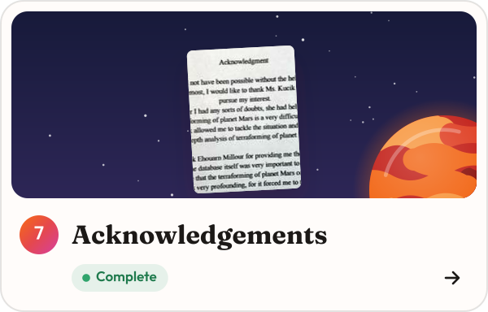

# Reviving the Fallen: Ways to terraform planet Mars

**Author:** Tahalil Morsilin

**Program:** Independent Research GT

**Year:** 2014-15

## Overview

The chances of planet Earth ever becoming too inhospitable for living organisms due to asteroid/meteor collision, or any other internal factor, such as global warming or perhaps human conflicts such as warfare, are extremely high, as each of these events have occurred, or in the process of occurring right now. The primary aim of this project is to better understand the concept of terraforming in order to increase the probability of human species' survival in the face of planet Mars, and come to a consensus about what is the best method for terraforming planet Mars that is both effective, and possible within the current technological standards. The data collection of Mars Climate Database (MCD) suggests that there is a relative relationship between the level of water vapor and temperature, and that relative, or perhaps balanced warming can give rise to the existence of water vapor, which is a fundamental force of terraforming. Ultimately, a short film will be produced that will summarize the journey of this research, and how it came to be and how the problem is a global issue rather than a science fiction. The video will also include various forms of animations that will present the process of terraforming as well as showcase the journey to planet Mars.

## Research question

<picture>
  <source media="(prefers-color-scheme: dark)" srcset="assets/research-question-dark.svg">
  
</picture>

## Table of contents

<p align="center">
  <a href="01-research-proposal/README.md"></a>
  <a href="02-abstract/README.md"></a>
  <a href="03-annotated-bibliography/README.md"></a>
  <a href="04-synthesis-paper/README.md"></a>
  <a href="05-primary-research/README.md"></a>
  <a href="06-final-product-and-presentations/README.md"></a>
  <a href="07-acknowledgements/README.md"></a>
</p>

All seven sections are transcribed from the printed pages. Each section has a `scans/` folder for photographs of the original pages.

## Repository structure

```text
.
├── README.md
├── .gitignore
├── 01-research-proposal/
│   ├── README.md
│   └── scans/
├── 02-abstract/
│   ├── README.md
│   └── scans/
├── 03-annotated-bibliography/
│   ├── README.md
│   └── scans/
├── 04-synthesis-paper/
│   ├── README.md
│   └── scans/
├── 05-primary-research/
│   ├── README.md
│   └── scans/
├── 06-final-product-and-presentations/
│   ├── README.md
│   └── scans/
└── 07-acknowledgements/
    ├── README.md
    └── scans/
```
